# Penance V5 — chapter geography and expansion graph

All fourteen regions are spatially reserved. The saved map implements a condensed opening preview; later chapter systems are planned, not production-ready.

```mermaid
flowchart LR
 C1["1. The Return"]
 C2["2. A Light in the Window"]
 C3["3. The Forgotten Neighborhood"]
 C4["4. Innocence"]
 C5["5. The Last Ordinary Day"]
 C6["6. The Missing Records"]
 C7["7. The Unmarked"]
 C8["8. Beneath the Water"]
 C9["9. The Crossing"]
 C10["10. Confession"]
 C11["11. The First Descent"]
 C12["12. The Grounds"]
 C13["13. The Erased"]
 C14["14. Penance"]
 C1 --> C2
 C2 --> C3
 C3 --> C4
 C4 --> C5
 C5 --> C6
 C6 --> C7
 C7 --> C8
 C8 --> C9
 C9 --> C10
 C10 --> C11
 C11 --> C12
 C12 --> C13
 C13 --> C14
 C11 -. garden shortcut .-> C10
 C12 -. return bridge .-> C6
 C14 -. changed familiar route .-> C2
```

## 1. The Return

**Objective:** Reach the lit house.
**Required path:** GAS → H01.
**Survival:** No clear enemy sighting.
**Optional:** Gas register, Bus shelter.
**Obstacle / unlock:** Visible road washout; Reach the house.
**Exit / return:** H01; Gas forecourt.

- Arrival
- Interrupted refueling
- Road washout
- Warm window reveal

## 2. A Light in the Window

**Objective:** Escape the changed house.
**Required path:** H01.
**Survival:** Brief stationary Penance in the hall.
**Optional:** Childhood room.
**Obstacle / unlock:** Changed exit; Enter then leave House01.
**Exit / return:** Orchard Loop; Side yard.

- Familiar doorway
- Childhood echo space
- Silhouette
- Changed side-yard exit

## 3. The Forgotten Neighborhood

**Objective:** Find the school route.
**Required path:** H03 → H05 → SCHOOL.
**Survival:** Dead-end escape reserved.
**Optional:** H04 yard, H12 dead-end.
**Obstacle / unlock:** Park shortcut fence; Orchard memory checkpoint.
**Exit / return:** School Lane; Park service path.

- Repeat street
- Changed parked car
- Dead-end reserve
- Shortcut opens

## 4. Innocence

**Objective:** Reach the park overlook.
**Required path:** SCHOOL → PARK.
**Survival:** Threat-free relief, later memory echo.
**Optional:** School playground.
**Obstacle / unlock:** School rear access; Park checkpoint.
**Exit / return:** Main Street; Creek trail.

- Empty classroom reserve
- Playground
- Sister memory reserve
- Church glimpse

## 5. The Last Ordinary Day

**Objective:** Restore one block of power.
**Required path:** DINER → BARBER → POST.
**Survival:** Dark kitchen escape reserved.
**Optional:** Hardware store.
**Obstacle / unlock:** Unpowered service door; Power restoration puzzle planned.
**Exit / return:** LIBRARY; Commercial rear alley.

- Interrupted meal
- Breaker route
- Power returns
- Last-night reconstruction

## 6. The Missing Records

**Objective:** Reach the municipal records wing.
**Required path:** LIBRARY → HALL → SHERIFF.
**Survival:** Archive evasion reserved.
**Optional:** Postal sorting, Town Hall balcony.
**Obstacle / unlock:** Annex evidence cabinet; Core record scene planned.
**Exit / return:** CARE; Civic courtyard.

- Library reference
- Town Hall denial
- Sheriff annex
- Graveyard direction

## 7. The Unmarked

**Objective:** Reach the creek maintenance gate.
**Required path:** CARE → GRAVEYARD.
**Survival:** Wall-and-grave sightline escape reserved.
**Optional:** Unmarked plots.
**Obstacle / unlock:** Caretaker gate; Burial-record scene planned.
**Exit / return:** PUMP; Grave Lane.

- Caretaker room
- Missing names
- Terraced graves
- Creek path opens

## 8. Beneath the Water

**Objective:** Make the crossing approach safe.
**Required path:** PUMP → BRIDGE.
**Survival:** Pump hazard/evasion reserved.
**Optional:** Utility yard, Old mill footing.
**Obstacle / unlock:** Sluice machinery; Pump environmental puzzle planned.
**Exit / return:** BRIDGE; Creek maintenance trail.

- Bank descent
- Pump chamber reserve
- Flood bypass
- Bridge approach

## 9. The Crossing

**Objective:** Reach the old church road.
**Required path:** BRIDGE → CHURCH.
**Survival:** Exposed crossing, no early patrol.
**Optional:** Old footbridge.
**Obstacle / unlock:** Creek and steep banks; Crossing event planned.
**Exit / return:** CHURCH; Return bridge.

- Bridge exposure
- Forest compression
- Ridge road cut
- Church threshold

## 10. Confession

**Objective:** Find the basement stair.
**Required path:** CHURCH.
**Survival:** Door-opening set piece planned; open entry in preview.
**Optional:** Church office reserve.
**Obstacle / unlock:** Office/archive doors planned; Nave checkpoint.
**Exit / return:** BASEMENT; Rear church path.

- Grand entrance
- Empty pews
- Archive reserve
- Service stair

## 11. The First Descent

**Objective:** Escape to the grounds.
**Required path:** BASEMENT → FOSTER.
**Survival:** Scripted no-damage chase preview.
**Optional:** Maintenance alcove.
**Obstacle / unlock:** Estate gate until escape; Reach west escape stair.
**Exit / return:** FOSTER; Garden back path.

- Descent
- Penance appears
- Two-route cover space
- Escape stair
- Estate reveal

## 12. The Grounds

**Objective:** Reach the estate entry.
**Required path:** LODGE → FOSTER.
**Survival:** Garden stealth routes reserved.
**Optional:** Greenhouse, Carriage house.
**Obstacle / unlock:** Estate threshold; Grounds sequence planned.
**Exit / return:** FOSTER interior; Garden service loop.

- Gate lodge
- Garden approach
- Outbuildings
- Main threshold

## 13. The Erased

**Objective:** Recover the sister’s fuller story.
**Required path:** FOSTER.
**Survival:** Interior survival reserved.
**Optional:** Personal belongings.
**Obstacle / unlock:** Interior locked wing planned; Core revelation scene planned.
**Exit / return:** Return town; Estate service exit.

- Sister’s room reserve
- Evidence of child
- Institutional link
- Return route

## 14. Penance

**Objective:** Confront what the town concealed.
**Required path:** CHURCH → HALL → H01.
**Survival:** Final confrontation reserved.
**Optional:** Optional ending discoveries.
**Obstacle / unlock:** Narrative resolution undecided; Future chapter implementation.
**Exit / return:** Ending undecided; Established return routes.

- Altered church
- Changed square
- Disappearance reconstruction
- Confrontation

